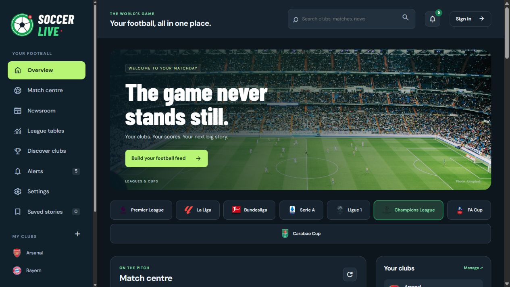
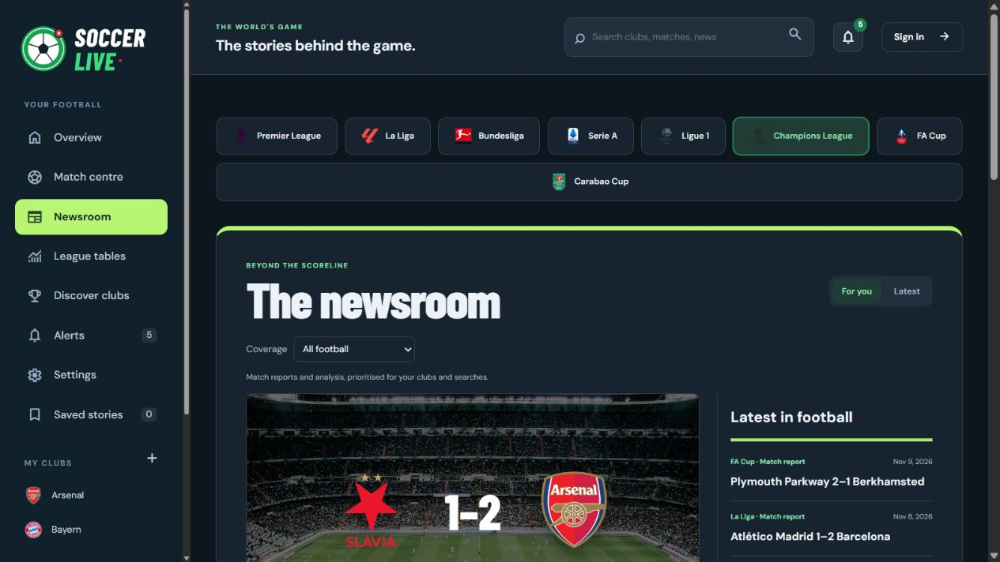
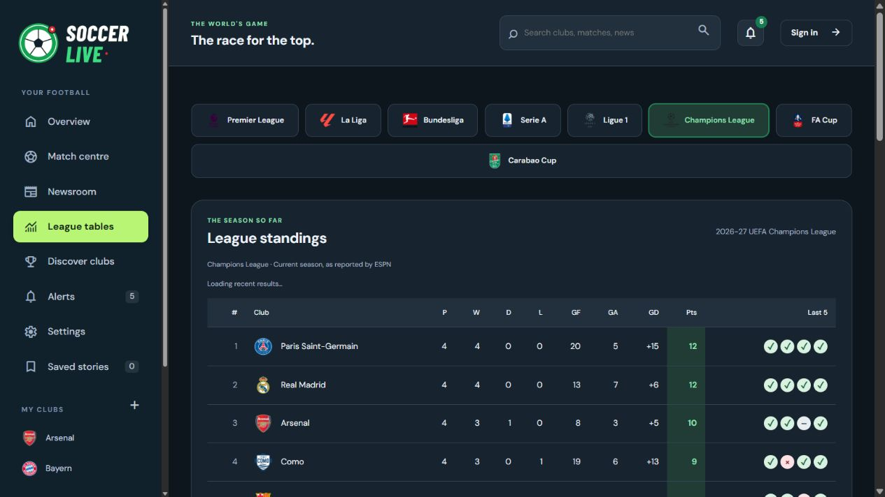

# Soccer Live

Soccer Live is a football hub with scores, fixtures, club follows, and a personalized news feed. The existing account pages use Supabase Auth.

## Football app

[Open Soccer Live](https://otaku-ace-coder.github.io/soccer-live/football.html)

The app has dedicated overview, match centre, newsroom, standings, club discovery, and saved-story views.

- Premier League, La Liga, Bundesliga, Serie A, Ligue 1, Champions League, FA Cup, and Carabao Cup feeds. The domestic cups display fixtures and results in place of a league table.
- Latest matchday, date picker, yesterday/today/tomorrow, live and followed-club filters.
- Match statistics including possession, shots, shots on target, corners, and fouls when supplied.
- Current league tables and club profiles with related matches and stories.
- A newsroom with original data-driven match reports, football explainers, personalised ranking, and a saved reading list. Articles open inside Soccer Live.
- Club follows, searches, and saved stories persist in browser storage. Existing Touchline follows migrate automatically. These preferences currently stay on the device.
- Desktop sidebar with club badges, competition badges, stadium photography, and mobile navigation.
- Supabase sign-up, login, recovery, and account pages remain connected to the app.

The app reads publicly accessible ESPN website feeds directly. These are unofficial integration endpoints and may change or fail. Each panel displays an unavailable state on errors. Scores refresh every minute in an active tab. Refresh reloads match reports and standings. Match reports are generated from recorded results and available statistics. No match scores or statistics are invented.

Club and league badge sources are recorded in `football-catalog.json`. The bundled FA Cup crests come from the clubs’ Wikipedia articles and the Stafford Rangers club site. Match and standings data come from ESPN’s public website feeds. The stadium photograph is served from the bundled Unsplash asset.

## Screenshot previews

### Overview

### Newsroom

### League standings

## Fixtures, squads, and recent form

- Match centre lists scheduled matches for the next 14 days in the selected competition.
- Club profiles show the current squad and upcoming club fixtures. Match details show reported starters, formations and substitutes when available.
- The league table shows the last five completed matches in the selected competition, oldest to newest. Each mark includes the opponent, score and date.
- Player photos use the match feed, official Real Madrid, FC Barcelona and UEFA squad portraits, and the Premier League portrait index. Names are matched before loading photos. Initials appear when a photo is unavailable.

## News alerts

Open the bell to follow competitions or Ballon d’Or and choose which updates appear in your inbox. The app checks the supported competition score feeds every three minutes while the page is visible. Recent completed match reports and dated editorial stories can generate alerts. The inbox and unread counts are saved in the current browser. Ballon d’Or coverage comes from Soccer Live editorial articles added to the site.

## Appearance

Open Settings to select light, dark, or your device’s theme. The preference is saved in the current browser and shared with the account pages.

## Local checks

Run `node --check football.js` and `node --test auth.test.cjs`. Browser checks should cover a date change, league switch, match details, follow/unfollow, search, saved-story reload persistence, and mobile navigation.

## Account previews

- [Preview directory](https://otaku-ace-coder.github.io/soccer-live/preview.html)
- [Sign up](https://otaku-ace-coder.github.io/soccer-live/index.html)
- [Log in](https://otaku-ace-coder.github.io/soccer-live/index.html?view=login)
- [Reset password](https://otaku-ace-coder.github.io/soccer-live/index.html?view=reset)

The previews use the live forms. Sign-up and password reset can send emails. The account page opens after sign-in.

## Run locally

Serve the project folder over HTTP and open `http://localhost:8000/preview.html`. From the project folder, run `python -m http.server 8000`. For the local confirmation and reset links, allow `http://localhost:8000/index.html` in Supabase.

## Supabase setup

1. Create a Supabase project. In its API settings, copy the project URL and **publishable** key (`sb_publishable_…`) into `config.js`. A legacy **anon** key also works. These values are public. Never paste a secret key (`sb_secret_…`), `service_role` key, database password, or SMTP credentials into this repository or frontend. Runtime key checks cannot make an already published secret safe; rotate any exposed secret immediately.
2. Enable the Email provider in Authentication settings. Enable email confirmation for registration, and set the server password minimum to at least 8 characters (the client uses 8). Stronger server rules are enforced by Supabase and displayed in the form.
3. Under Authentication → URL Configuration, set Site URL to your deployed site and allow the exact callback URL `https://your-domain/path/index.html`. For local development also allow `http://localhost:8000/index.html`. Use the same host consistently; localhost and 127.0.0.1 have separate storage. Keep confirmation/reset email templates using Supabase's standard `ConfirmationURL` link.
4. Configure custom SMTP for production confirmation and recovery emails. The default sender is restricted and is suitable only for testing with allowed recipients. SMTP credentials belong in Supabase settings only.
5. Serve this directory over HTTP locally, for example `python -m http.server 8000`, then open `http://localhost:8000/index.html`. Do not open HTML as `file://`. Deploy over HTTPS. The SDK loads from a pinned esm.sh URL and requires internet access.

## Flow and storage

- `auth-client.js` creates the shared Supabase client. `script.js` handles email/password login, registration, confirmation callbacks, reset emails and password updates. Passwords go directly to Supabase over HTTPS; application code does not store or log them.
- Registration either establishes a session (when confirmation is disabled) or asks the user to check email. Reset requests give a generic success message to avoid exposing account existence. Supabase validation, rate-limit and connection errors appear in the live status message. Fields also use native required/email/password validation and confirmation matching.
- This static browser app explicitly uses the implicit email callback flow. The SDK consumes callback tokens from the URL and emits `PASSWORD_RECOVERY` to show the new-password form; application code then clears the fragment. Do not add third-party analytics that might capture callback URLs. Password-reset links are single use and expire according to project settings.
- The SDK stores access/refresh tokens in browser localStorage, restores sessions and refreshes tokens automatically. Sessions persist across browser restarts until sign-out or expiry/revocation. The old nonfunctional Remember me checkbox has been removed to avoid suggesting a storage choice that does not exist. Never use a shared browser without signing out. Browser tokens are accessible to JavaScript: avoid untrusted scripts and HTML injection. User values/messages are rendered via `textContent`.
- `protected.js` checks `getUser()` with Supabase before revealing the account view, redirects unauthenticated visitors, listens for sign-out (including across tabs), and signs out through Supabase. If configuration or SDK loading fails, content remains hidden and an error is shown.

## Access control boundary

Password recovery survives a reload in the same tab using a sessionStorage marker containing only the user ID, never a password or token. The marker only selects the form; Supabase still authorizes the password update. It is cleared on successful update or sign-out. Stored sessions are verified before automatic navigation, so revoked sessions do not cause redirect loops. Network failures keep account content hidden and display an error.

`protected.html` is a client-side session gate, not a private server resource. Its static HTML/JS can always be downloaded. It contains no confidential data. Any future private data must be protected by Supabase Row Level Security (RLS) with policies tied to `auth.uid()`, or by a backend that validates tokens. Never rely on hidden HTML or browser redirects as data authorization. No database tables or RLS policies are needed for the current account-only page.

## Verification checklist (requires a configured project)

Run `node --test auth.test.cjs` for the local mocked flow tests. These verify application behavior, not live Supabase delivery, browser layout, or server configuration.

- Register with matching passwords; follow confirmation email; verify login and reload persistence.
- Test wrong password, malformed email, mismatched/short passwords and stronger server password rules.
- Request recovery while logged out and while logged in; open the link, change password, sign out, then verify only the new password works. Check expired/used reset links show an error.
- Open `protected.html` without a session: it must redirect without showing account details. With a valid session, it must display the signed-in email.
- Sign out and check the protected page in another tab also redirects. Test token expiry/revocation, offline behavior, and SDK/configuration failures.
- Check desktop/mobile layouts and keyboard focus. Do not use real credentials in screenshots, logs or committed fixtures.

References: [Password-based Auth](https://supabase.com/docs/guides/auth/passwords), [resetPasswordForEmail](https://supabase.com/docs/reference/javascript/auth-resetpasswordforemail), [Auth events](https://supabase.com/docs/reference/javascript/auth-onauthstatechange), [API keys](https://supabase.com/docs/guides/api/api-keys).
